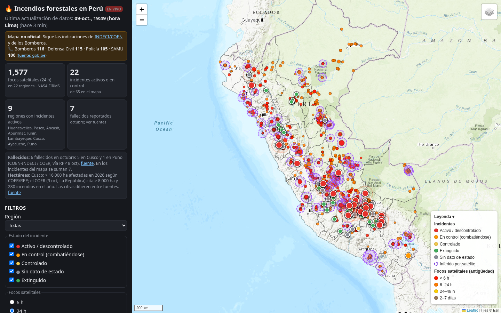

# 🔥 Incendios forestales en Perú – mapa en vivo

Mapa web **no oficial** que reúne en un solo lugar:

- **Focos de calor satelitales** de la NASA (FIRMS): VIIRS S-NPP, VIIRS NOAA-20, VIIRS NOAA-21 y MODIS (Terra/Aqua), de las últimas 6 h, 24 h, 48 h o 7 días.
- **Incidentes reportados** con su estado (activo/descontrolado, en control, controlado, extinguido o sin dato), hectáreas, víctimas y la fecha de la última actualización. Cada dato enlaza a su fuente (COEN-INDECI, COER, Agencia Andina, prensa).
- **Agrupaciones de focos inferidas por satélite**, siempre marcadas como *inferido por satélite* y nunca como confirmadas.
- **Últimas noticias** (Google Noticias) y contadores: focos, incidentes activos, regiones y fallecidos reportados.

**Interfaz 3D (three.js).** Muestra un Perú en relieve con sus regiones y nombres. Los incendios aparecen como columnas de fuego, y su altura crece con las hectáreas reportadas. Los puntos de calor satelitales forman una capa sutil. Arriba hay un titular en lenguaje simple ("Ahora hay N incendios activos en M regiones") y debajo una leyenda de 4 colores. También tiene un botón **Ver mi región**, la lista **Incendios más graves ahora** y tarjetas simples con lugar, estado, hectáreas, desde cuándo, qué hacer, teléfonos 116 y 115, y noticias. Los datos técnicos (FRP, sensor, confianza, todas las fuentes) están detrás de **Ver datos técnicos**. Si el dispositivo no tiene WebGL, se muestra la lista y un enlace al [mapa 2D clásico](mapa-2d.html) (Leaflet).

Se actualiza solo. El actualizador corre **cada 10 minutos** y la página revisa **cada minuto** si hay datos nuevos, sin que tengas que recargarla. Sitio principal: **<https://peruvian.dev/incendios/>**.

**Novedades.** La pestaña *Novedades* es un feed que se genera solo comparando cada actualización con la anterior: nuevos incendios reportados, cambios de estado (de activo a controlado, etc.), nuevos reportes de INDECI, cifras de hectáreas o víctimas que cambian, nuevas agrupaciones de calor vistas por satélite y titulares de prensa. Cada novedad enlaza a su fuente y, si es de un incendio, lo centra en el mapa. Las que llegan mientras tienes la página abierta se marcan como nuevas y aparece un aviso.

**Estado del monitoreo.** La píldora de arriba muestra de cuándo son los datos y cuándo llega la próxima actualización; al tocarla se ve la salud de cada fuente, la duración de las corridas y la tendencia de las últimas 48 h. También hay una página aparte, [`estado.html`](estado.html), con el historial de 7 días.

> ⚠️ **Aviso.** Esta herramienta es informativa y **no es una fuente oficial**. En una emergencia sigue las indicaciones de [INDECI / COEN](https://portal.indeci.gob.pe/emergencias/), del Cuerpo General de Bomberos Voluntarios del Perú y de tu gobierno local.
>
> **Teléfonos de emergencia** (verificados en [gob.pe](https://www.gob.pe/547-telefonos-de-emergencia) el 9 oct 2026): Bomberos **116** · Defensa Civil **115** · Policía **105** · SAMU **106** (en las regiones que cubre). Vuelve a verificarlos antes de difundirlos.



## Fuentes de datos

| Capa | Fuente | Cómo se obtiene |
|---|---|---|
| Focos de calor | [NASA FIRMS](https://firms.modaps.eosdis.nasa.gov/) (VIIRS 375 m, MODIS 1 km, datos casi en tiempo real) | CSV públicos de Sudamérica de 7 días (sin clave) o la API de área si configuras `FIRMS_MAP_KEY`. Se filtran solo los puntos dentro de Perú usando los límites departamentales. |
| Incidentes oficiales | [COEN-INDECI – Emergencias](https://portal.indeci.gob.pe/emergencias/) | Se lee el listado de reportes "INCENDIO FORESTAL EN EL DISTRITO DE …" y se abre el PDF del último reporte de cada distrito. Del PDF se extraen la frase de estado ("El incendio se encuentra ACTIVO/CONTROLADO/EXTINGUIDO"), la hora de actualización, la ubicación, las hectáreas de cobertura natural y las víctimas. |
| Incidentes curados | `data/incidentes_curados.json` | Están cargados a mano con cita textual y enlace: COEN-INDECI, COER Cusco, Agencia Andina, RPP, La República, Canal N, EFE/Forbes Perú, etc. Si INDECI publica un reporte **más reciente** para el mismo distrito, se usa su estado y se indica el origen. |
| Reportes de incendio SERFOR | [GEOSERFOR](https://geo.serfor.gob.pe/visor/), Unidad de Monitoreo Satelital (servicio ArcGIS REST público `Visor/Incendios_Forestales`) | Reportes de los últimos 14 días agrupados por código (`PIF_…`), con su estado oficial (Alertado, Confirmado, Controlado, Extinguido), cobertura y área protegida. Si coinciden con un incidente (mismo distrito o ≤ 10 km) se adjuntan a él; si no, se crea uno. «Confirmado» sin detecciones en 48 h se muestra como «sin dato». También se leen los focos de 24 h clasificados en cobertura forestal o agrícola. |
| Notas oficiales | gob.pe: INDECI, SERFOR, SENAMHI, MINAM y los gobiernos regionales de Cusco, Apurímac, Ayacucho, Puno, Junín, Huancavelica, Pasco y Áncash | Notas de prensa sobre incendios forestales (cada institución, cada ~20 min). |
| Clima | [Open-Meteo](https://open-meteo.com/) | Temperatura, humedad, viento y días sin lluvia en cada incendio activo (cada ~30 min). Es meteorología, no un índice oficial de riesgo; para eso, los avisos de [SENAMHI](https://www.senamhi.gob.pe/site/incendio/). |
| Noticias | Google Noticias RSS (`incendio forestal Perú`, regiones afectadas) y RSS de Andina | Titulares de los últimos 3 días, con enlace. De Andina solo pasan las notas sobre fuego en zonas rurales o forestales. |
| Mapas base | OpenStreetMap, Esri (relieve y satélite), [NASA GIBS](https://www.earthdata.nasa.gov/engage/open-data-services-software/earthdata-developer-portal/gibs-api) (VIIRS/MODIS en color verdadero y aerosoles/humo del día anterior) | Teselas públicas |
| Límites y centroides | [juaneladio/peru-geojson](https://github.com/juaneladio/peru-geojson) (departamentos y distritos, INEI) | `data/ref/` |

### Reglas para no inventar datos

- Todo estado y toda cifra de un incidente proviene de una fuente citada en su ventana emergente. Si no hay dato, se muestra **"sin dato"**.
- Los estados que se leen automáticamente de los PDF de INDECI se marcan como *leído automáticamente* e incluyen la frase original entre comillas.
- **"Actividad satelital reciente"** significa que hubo al menos un foco FIRMS en las últimas 24 h a ≤ 15 km del punto del incidente. Es un indicio, no una confirmación de que el fuego siga activo.
- Las agrupaciones de 3 o más focos en 24 h que estén a más de 20 km de cualquier incidente conocido se muestran como **"inferido por satélite"**. Pueden ser quemas agrícolas.
- La ubicación de los incidentes es el **centroide del distrito**, salvo que se indique otra cosa. No es el frente de fuego.

## Frecuencia de actualización

- **Servidor propio (peruvian.dev/incendios):** un timer de systemd corre `scripts/update.py` cada 10 minutos (`deploy/server/incendios-update.timer`). Un vigía (`incendios-watchdog`, cada 2 minutos) avisa por Telegram si los datos llevan más de 25 minutos sin renovarse, si el sitio no responde, si el actualizador falla dos corridas seguidas o si una fuente lleva tres corridas fallando.
- **GitHub Pages (espejo):** el workflow `.github/workflows/actualizar.yml` corre con cron `*/10 * * * *`, pero GitHub suele retrasar o saltarse ejecuciones programadas. También corre con cada push a `main` y a mano desde *Actions → Run workflow*.
- **Satélites:** FIRMS publica cada pasada unas 3 h después de la observación, como máximo. Cada satélite VIIRS/MODIS pasa sobre Perú unas 2 veces al día.
- **Navegador:** la página consulta `data/meta.json` (2 KB) cada minuto y cuando vuelves a la pestaña. Solo si cambió baja el resto; primero carga `firms_24h.json` (unos 120 KB) y los 7 días completos (1,6 MB) solo si los pides en *Ver datos técnicos*.

## Estructura

```
index.html               página principal: mapa 3D (three.js r170, incluido en assets/vendor, sin compilación ni CDN)
assets/app3d.js          escena 3D, tarjetas, lista por gravedad, feed de novedades, estado del monitoreo, región, compartir
assets/style.css         estilos (primero para celulares); fuente Archivo en assets/fonts
estado.html              página de estado del monitoreo (assets/estado.js, assets/style-estado.css)
mapa-2d.html             mapa 2D clásico (Leaflet, en assets/vendor/leaflet), también sirve de respaldo sin WebGL
assets/app-2d.js, assets/style-2d.css
manifest.json            para «añadir a la pantalla de inicio»
scripts/update.py        actualizador (Python estándar + pdftotext)
deploy/run.sh            publica en el servidor; deploy/server/ trae el script de despliegue, las unidades systemd, el vigía y el snippet de nginx
data/incidentes_curados.json   incidentes cargados a mano, con fuentes
data/firms.json          focos satelitales en Perú (7 días)      ← generado
data/firms_24h.json      solo las últimas 24 h (carga inicial)   ← generado
data/indeci.json         últimos reportes COEN de incendio forestal ← generado
data/incidentes.json     incidentes fusionados + inferidos        ← generado
data/noticias.json       titulares                                ← generado
data/oficial.json        notas oficiales sobre incendios (gob.pe)      ← generado
data/novedades.json      feed de novedades (diferencias entre corridas, 7 días) ← generado
data/historial.json      conteos por corrida (7 días)             ← generado
data/health.json         salud del actualizador: duración, fallos seguidos por fuente, últimas corridas ← generado
data/meta.json           conteos, hora de generación, estado de fuentes ← generado
data/ref/                límites departamentales y centroides distritales
```

Con `INCENDIOS_OUT=/otra/carpeta` el actualizador escribe los archivos generados fuera de `data/` (así corre en el servidor como un usuario sin permisos sobre el código). Devuelve código 1 si ninguna fuente respondió; en ese caso conserva `meta.json` para que la página y el vigía noten el atraso.

## Correrlo localmente

```bash
sudo apt-get install poppler-utils   # pdftotext
python3 scripts/update.py            # descarga y genera data/*.json (~1–3 min)
python3 -m http.server 8000          # abre http://localhost:8000
```

## Agregar una clave de NASA FIRMS (opcional)

Sin clave se usan los CSV públicos de 7 días, que bastan. Con clave se consulta la API por área (solo el rectángulo de Perú):

1. Pide una MAP_KEY gratuita en <https://firms.modaps.eosdis.nasa.gov/api/map_key/>.
2. En GitHub ve a **Settings → Secrets and variables → Actions → New repository secret**, con nombre `FIRMS_MAP_KEY`.
3. Localmente: `FIRMS_MAP_KEY=tu_clave python3 scripts/update.py`.

Si la API falla, el script vuelve solo a los CSV públicos.

## Desplegar

**Servidor propio (como peruvian.dev/incendios).** Una sola vez, como root: `scp -r deploy/server lima:/tmp/incendios-server && ssh lima 'bash /tmp/incendios-server/install.sh'` crea el usuario `incendios`, instala `incendios-update.timer` (cada 10 min), `incendios-watchdog.timer` (cada 2 min), el script `/usr/local/sbin/incendios-deploy` y el snippet de nginx `/incendios/` (con CSP estricta: todo se sirve desde el propio sitio, salvo las teselas del mapa 2D). Después, cada publicación es `bash deploy/run.sh`: valida el paquete, activa la versión nueva con un rename atómico en `/srv/incendios`, copia el actualizador a `/opt/incendios` y lanza una corrida. Los datos viven en `/srv/incendios-data`. Un archivo de datos que aún no existe responde `{}` con 200, para que ninguna petición de la página termine en 404 (CrowdSec). Clave opcional de FIRMS en `/etc/incendios/env`.

**GitHub Pages (espejo).** Ve a *Settings → Pages → Source: GitHub Actions*. El mismo workflow actualiza los datos y publica el sitio, y los datos que genera en cada ejecución **no** se suben al repositorio, para que no crezca con cada actualización (el repositorio solo trae una instantánea inicial del 9 de octubre de 2026). Entre ejecuciones se conservan con `actions/cache`.

**Otro hosting estático** (Vercel, Netlify, Cloudflare Pages): sirve la carpeta raíz tal cual y programa `python3 scripts/update.py` en un cron que vuelva a publicar.

## Agregar o corregir un incidente

Edita `data/incidentes_curados.json`. Los estados válidos son `activo`, `en_control`, `controlado`, `extinguido` y `sin_dato`. Usa `null` cuando no haya dato y agrega siempre al menos una fuente con `url`. Los nombres de departamento, provincia y distrito van en mayúsculas y sin tildes, como en `data/ref/distritos.json`.

## Limitaciones

- El mapa 3D usa los límites departamentales simplificados, sin relieve real del terreno. Para ver imágenes satelitales y relieve usa el mapa 2D.
- Para que vaya fluido en celulares se dibujan como máximo 6 000 puntos de calor, los más recientes.

- Los focos FIRMS tienen una resolución de 375 m a 1 km. Las nubes, el humo denso o la hora de la pasada pueden ocultar un incendio, y algunas quemas agrícolas o fuentes industriales aparecen como focos.
- La lectura automática de los PDF de INDECI depende de su formato. Si cambia, el estado queda en "sin dato", con el enlace al reporte.
- Las cifras de hectáreas y víctimas cambian entre fuentes y entre un reporte y otro. Por eso se muestran con su fuente y fecha, y nunca se suman fuentes distintas.
- Google Noticias puede cambiar o limitar su RSS.

## Licencia

Código bajo licencia MIT. Los datos pertenecen a sus respectivas fuentes: NASA FIRMS/GIBS (dominio público), INDECI (Estado peruano) y los medios citados.
